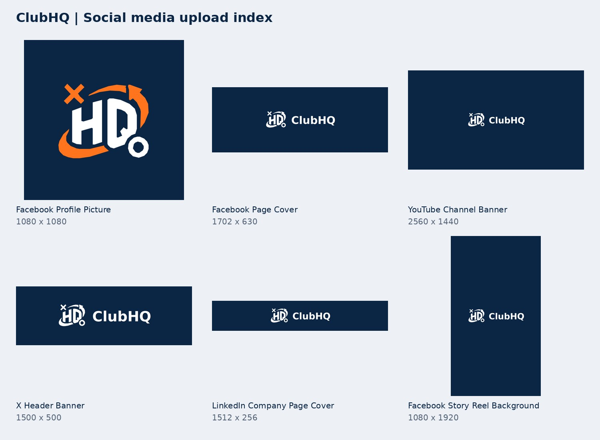

# ClubHQ social media kit

Approved HQ Motion — Refined Balance artwork. Exported October 23, 2026.

## Pick your image

Open the folder named for the platform. Use `Profile_Picture` for the avatar, `Page_Cover`, `Header_Banner`, or `Channel_Banner` for the wide image at the top of a page. File names describe the actual use; dimensions and descriptions are below.

Profile pictures have padding for a circular crop. Keep the full image when uploading. Banners keep the logo near the center; inspect the platform crop preview before saving. PNG files are ready to upload. SVG files are editable masters, not profile uploads.

The logo geometry and existing approved wordmark are preserved, using the current approved repository vectors, which omit the background-corner tracing artifacts present in the older download. No new logo design was generated.

## Files

| File | Pixels | Use |
| --- | --- | --- |
| [Facebook/Facebook_Profile_Picture.png](<Facebook/Facebook_Profile_Picture.png>) | 1080 × 1080 | Upload as profile picture/logo. Keep the full square; circular crop is already accommodated. |
| [Instagram/Instagram_Profile_Picture.png](<Instagram/Instagram_Profile_Picture.png>) | 1080 × 1080 | Upload as profile picture/logo. Keep the full square; circular crop is already accommodated. |
| [TikTok/TikTok_Profile_Picture.png](<TikTok/TikTok_Profile_Picture.png>) | 1080 × 1080 | Upload as profile picture/logo. Keep the full square; circular crop is already accommodated. |
| [YouTube/YouTube_Profile_Picture.png](<YouTube/YouTube_Profile_Picture.png>) | 1080 × 1080 | Upload as profile picture/logo. Keep the full square; circular crop is already accommodated. |
| [X/X_Profile_Picture.png](<X/X_Profile_Picture.png>) | 400 × 400 | Upload as profile picture/logo. Keep the full square; circular crop is already accommodated. |
| [LinkedIn/LinkedIn_Profile_Picture.png](<LinkedIn/LinkedIn_Profile_Picture.png>) | 400 × 400 | Upload as profile picture/logo. Keep the full square; circular crop is already accommodated. |
| [Threads/Threads_Profile_Picture.png](<Threads/Threads_Profile_Picture.png>) | 1080 × 1080 | Upload as profile picture/logo. Keep the full square; circular crop is already accommodated. |
| [Pinterest/Pinterest_Profile_Picture.png](<Pinterest/Pinterest_Profile_Picture.png>) | 1080 × 1080 | Upload as profile picture/logo. Keep the full square; circular crop is already accommodated. |
| [Bluesky/Bluesky_Profile_Picture.png](<Bluesky/Bluesky_Profile_Picture.png>) | 1080 × 1080 | Upload as profile picture/logo. Keep the full square; circular crop is already accommodated. |
| [Discord/Discord_Profile_Picture.png](<Discord/Discord_Profile_Picture.png>) | 1080 × 1080 | Upload as profile picture/logo. Keep the full square; circular crop is already accommodated. |
| [Twitch/Twitch_Profile_Picture.png](<Twitch/Twitch_Profile_Picture.png>) | 1080 × 1080 | Upload as profile picture/logo. Keep the full square; circular crop is already accommodated. |
| [Facebook/Facebook_Page_Cover.png](<Facebook/Facebook_Page_Cover.png>) | 1702 × 630 | Upload as page cover. Keep centered; check the upload crop preview. |
| [YouTube/YouTube_Channel_Banner.png](<YouTube/YouTube_Channel_Banner.png>) | 2560 × 1440 | Upload as channel banner. Keep centered; check the upload crop preview. |
| [X/X_Header_Banner.png](<X/X_Header_Banner.png>) | 1500 × 500 | Upload as header banner. Keep centered; check the upload crop preview. |
| [LinkedIn/LinkedIn_Company_Page_Cover.png](<LinkedIn/LinkedIn_Company_Page_Cover.png>) | 1512 × 256 | Upload as company page cover. Keep centered; check the upload crop preview. |
| [Bluesky/Bluesky_Header_Banner.png](<Bluesky/Bluesky_Header_Banner.png>) | 1500 × 500 | Upload as header banner. Keep centered; check the upload crop preview. |
| [Twitch/Twitch_Profile_Banner.png](<Twitch/Twitch_Profile_Banner.png>) | 1200 × 480 | Upload as profile banner. Keep centered; check the upload crop preview. |
| [Facebook/Facebook_Story_Reel_Background.png](<Facebook/Facebook_Story_Reel_Background.png>) | 1080 × 1920 | Static 9:16 branded background for vertical content; this is not a video file. |
| [Instagram/Instagram_Story_Reel_Background.png](<Instagram/Instagram_Story_Reel_Background.png>) | 1080 × 1920 | Static 9:16 branded background for vertical content; this is not a video file. |
| [TikTok/TikTok_Vertical_Content_Background.png](<TikTok/TikTok_Vertical_Content_Background.png>) | 1080 × 1920 | Static 9:16 branded background for vertical content; this is not a video file. |
| [YouTube/YouTube_Vertical_Content_Background.png](<YouTube/YouTube_Vertical_Content_Background.png>) | 1080 × 1920 | Static 9:16 branded background for vertical content; this is not a video file. |
| [Threads/Threads_Vertical_Content_Background.png](<Threads/Threads_Vertical_Content_Background.png>) | 1080 × 1920 | Static 9:16 branded background for vertical content; this is not a video file. |
| [Pinterest/Pinterest_Vertical_Content_Background.png](<Pinterest/Pinterest_Vertical_Content_Background.png>) | 1080 × 1920 | Static 9:16 branded background for vertical content; this is not a video file. |
| [Shared Post Backgrounds/Square_Post.png](<Shared Post Backgrounds/Square_Post.png>) | 1080 × 1080 | Reusable branded still background. Add your post content in your editor. |
| [Shared Post Backgrounds/Portrait_Post.png](<Shared Post Backgrounds/Portrait_Post.png>) | 1080 × 1350 | Reusable branded still background. Add your post content in your editor. |
| [Shared Post Backgrounds/Landscape_Post.png](<Shared Post Backgrounds/Landscape_Post.png>) | 1920 × 1080 | Reusable branded still background. Add your post content in your editor. |
| [Shared Post Backgrounds/Pinterest_Pin.png](<Shared Post Backgrounds/Pinterest_Pin.png>) | 1000 × 1500 | Reusable branded still background. Add your post content in your editor. |
| [Transparent Overlays/ClubHQ_Logo_Color_Transparent.png](<Transparent Overlays/ClubHQ_Logo_Color_Transparent.png>) | 2048 × 2048 | Transparent logo overlay. Use on dark backgrounds. |
| [Transparent Overlays/ClubHQ_Logo_White_Transparent.png](<Transparent Overlays/ClubHQ_Logo_White_Transparent.png>) | 2048 × 2048 | Transparent logo overlay. Use on dark backgrounds. |
| [Transparent Overlays/ClubHQ_Logo_Navy_Transparent.png](<Transparent Overlays/ClubHQ_Logo_Navy_Transparent.png>) | 2048 × 2048 | Transparent logo overlay. Use on light backgrounds. |
| [Transparent Overlays/ClubHQ_Wordmark_White_Transparent.png](<Transparent Overlays/ClubHQ_Wordmark_White_Transparent.png>) | 1250 × 320 | Transparent approved monochrome wordmark for dark photos/videos. |
| [YouTube/YouTube_Video_Watermark.png](<YouTube/YouTube_Video_Watermark.png>) | 150 × 150 | Upload in YouTube Studio as the video watermark. |

## Coverage and upload notes

Folders cover Facebook, Instagram, TikTok, YouTube, X, LinkedIn, Threads, Pinterest, Bluesky, Discord and Twitch. Shared assets also work in other image-upload channels. Snapchat users can use the vertical backgrounds in content; this kit does not generate a Snapcode or replace a Bitmoji. Not every service offers a banner slot. These are branding assets, not an exhaustive set of advertising placements.

For Instagram/TikTok/Threads and other avatars, 1080 square is our high-resolution export choice, not a claimed platform minimum. Vertical and feed dimensions are reusable production canvases. Bluesky/Twitch headers are layout exports; preview cropping in the app. Facebook cover is supplied at twice the commonly used 851 × 315 canvas. Meta help was partially login-gated during verification.

YouTube banner: 2560 × 1440; content is inside the central safe region. X header: 1500 × 500. LinkedIn company Page cover: 1512 × 256, as specified by current LinkedIn Help (not the frequently repeated 4200 × 700 third-party figure).

## Sources checked October 23, 2026

- https://support.google.com/youtube/answer/10456525?hl=en
- https://help.x.com/en/managing-your-account/common-issues-when-uploading-profile-photo.html
- https://www.linkedin.com/help/linkedin/answer/a563309/image-specifications-for-your-linkedin-pages-and-career-pages
- https://www.facebook.com/help/125379114252045
- https://support.tiktok.com/en/getting-started/setting-up-your-profile/adding-a-profile-photo-or-video

## Maintenance

Use the approved vectors under `../vector/final` as the source of truth. Keep existing app assets and app code unchanged. Social files live only in this directory. Do not use the older DRAFT vector for new exports.
