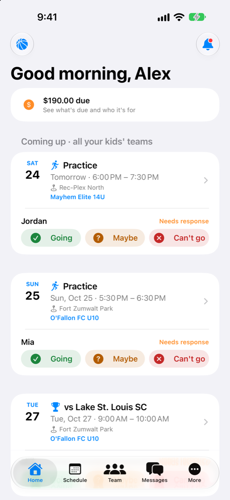
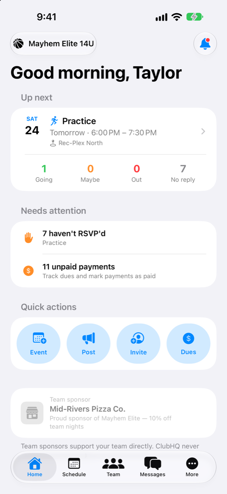
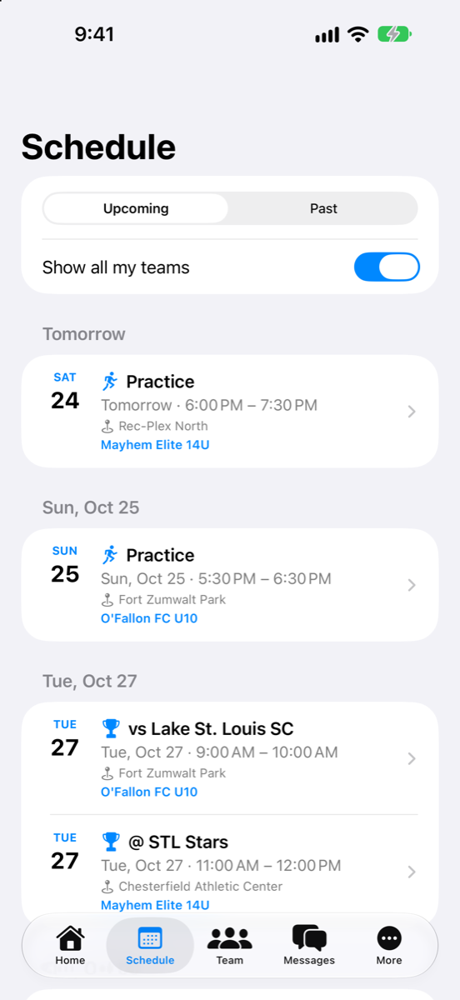
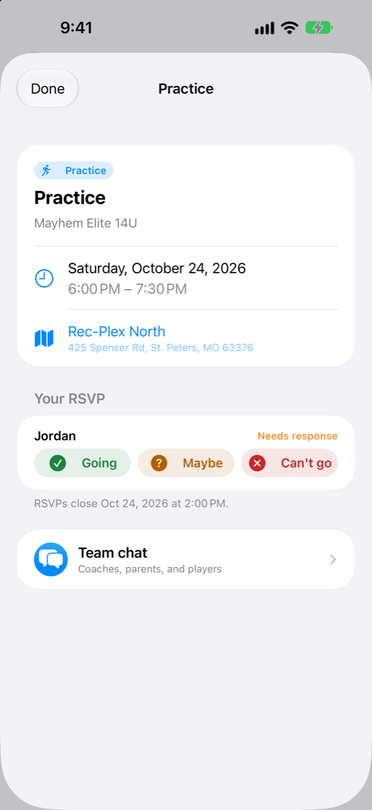
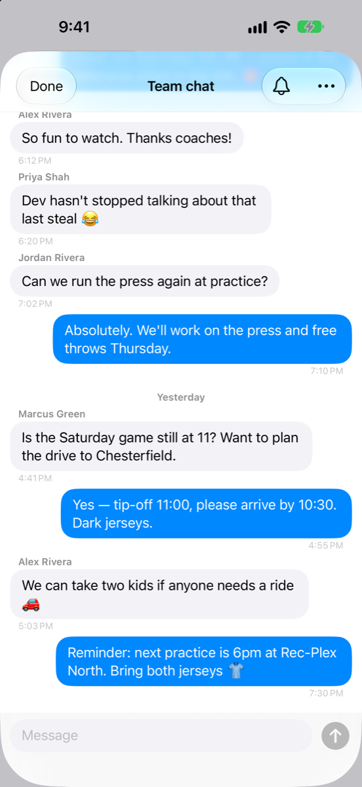
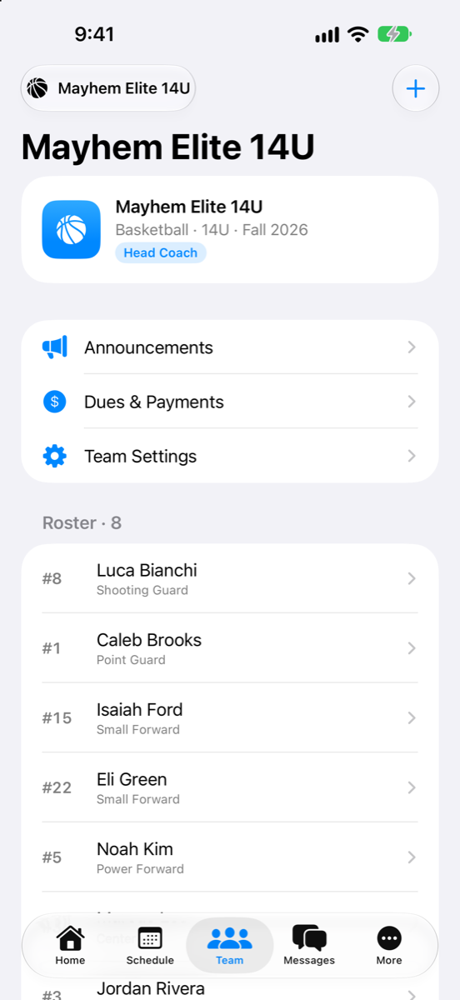
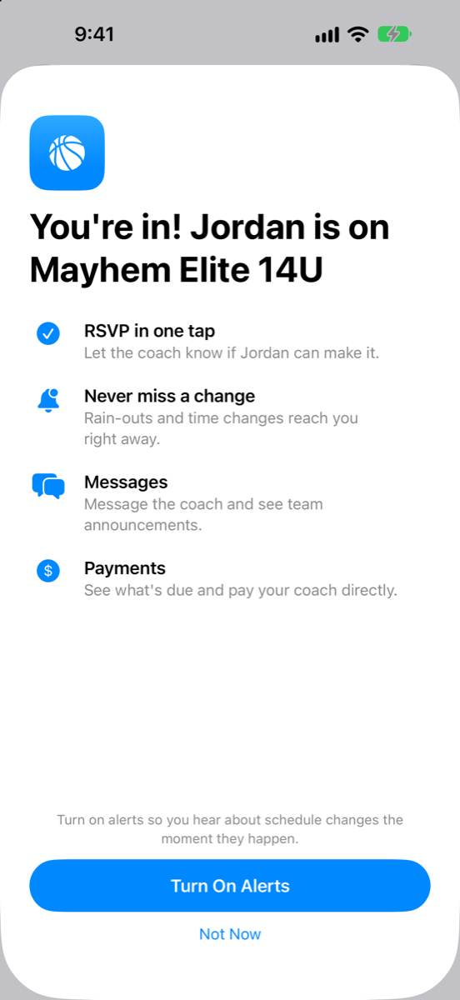

# ClubHQ for iPhone

An ad-free youth-sports team app for **coaches, parents, and players**: schedules, RSVPs,
attendance, team chat, announcements, and team dues. No ads, no trackers, and families'
data is never sold.

<table>
  <tr>
    <td align="center"> Parents: every kid, every team</td>
    <td align="center"> Coaches: what needs attention</td>
    <td align="center"> One schedule for all teams</td>
    <td align="center"> Event details and RSVP</td>
  </tr>
  <tr>
    <td align="center"> Team chat</td>
    <td align="center"> Team hub and roster</td>
    <td align="center"> First-run welcome tour</td>
    <td></td>
  </tr>
</table>

## What it does
**Coaches**
- Schedule practices and games; families are notified automatically.
- See who's coming (Going / Maybe / Out / No reply) and take attendance.
- Post announcements, run team chat, and message families.
- Collect dues: families get one-tap Venmo or Cash App buttons, and coaches mark payments paid.
- Invite families with one code or link. Parents add their own kids, so there's no roster typing.
- A "Get your team ready" checklist walks new coaches through setup, and coaches get a notification each time a family joins.

**Parents**
- One home screen for every child on every team, with one-tap RSVP.
- Push alerts for schedule changes, announcements, and messages.
- See what's due and pay the coach directly.
- **Co-parents** join the same child from an invite on the child's profile, so the roster doesn't get duplicates.

**Players (13+)**
- Their own login for the schedule, self-RSVP, and team chat. Players can't start private conversations.

**Everyone** gets a short role-specific welcome tour on first launch (replay it from More → Show App Tour). Invite links on teamclubhq.com open the app directly.

## Run it
1. Open `ClubHQ.xcodeproj` in Xcode 27 and pick an iPhone simulator (iOS 27).
2. Build & Run. The sign-in screen offers **Demo Mode**: pick Coach, Parent, or Player to explore a seeded team with no account. Switch roles any time under More → Demo mode.

Debug builds accept launch arguments for screenshots:
`-ScreenshotPersona coach|parent|player -ScreenshotTab home|schedule|team|messages -ScreenshotOpen chat|event|tour`
(see [`docs/APP_STORE.md`](docs/APP_STORE.md)).

To test Coach Pro purchases locally: Edit Scheme → Run → Options → StoreKit Configuration → `StoreKit/ClubHQ.storekit`.

## How it's built
- **SwiftUI**, iOS 27, no third-party dependencies. `AppModel` holds the session and teams; views talk to the `ClubHQBackend` protocol, which has a live `SupabaseBackend` and an in-memory `DemoBackend` used for Demo Mode, previews, and tests.
- **Supabase** backend (`supabase/`): Postgres with row-level security, plus Edge Functions. `mobile-api` handles privileged actions (teams, invites, dues, notifications), `apns-dispatch` sends push notifications, and webhooks handle Stripe and the App Store.
- **teamclubhq.com** (`site/`) on Cloudflare Pages serves the privacy, terms, and support pages and the invite landing page, and enables universal links.
- The iPhone app is the only client; an earlier web prototype is retired.

More detail in [`docs/ARCHITECTURE.md`](docs/ARCHITECTURE.md).

## Backend and releases
- **Backend:** migrations in `supabase/migrations/`, functions in `supabase/functions/`. The runbook is [`docs/DEPLOYMENT.md`](docs/DEPLOYMENT.md). Credentials live in a gitignored `.env.local`.
- **Website:** `scripts/deploy-site.sh` publishes `site/` to Cloudflare Pages.
- **App Store and TestFlight:** [`docs/APP_STORE.md`](docs/APP_STORE.md) and the scripts in `scripts/asc/`.

## Docs
| Doc | What's in it |
|---|---|
| [`docs/PRODUCT_STRATEGY.md`](docs/PRODUCT_STRATEGY.md) | Positioning vs TeamSnap, personas, revenue model, roadmap |
| [`docs/research/COMPETITIVE_ANALYSIS.md`](docs/research/COMPETITIVE_ANALYSIS.md) | Competitor, pricing, App Store, and COPPA research |
| [`docs/DECISIONS.md`](docs/DECISIONS.md) | Every "how" decision and why |
| [`docs/OPEN_QUESTIONS.md`](docs/OPEN_QUESTIONS.md) | Open questions for the owner |
| [`docs/ARCHITECTURE.md`](docs/ARCHITECTURE.md) | How the pieces fit |
| [`docs/DEPLOYMENT.md`](docs/DEPLOYMENT.md) | Backend rollout runbook |
| [`docs/APP_STORE.md`](docs/APP_STORE.md) | App Store listing, TestFlight, and review notes |
| `design/app-icon/` | Icon concepts; A · Home Court is the chosen icon |
